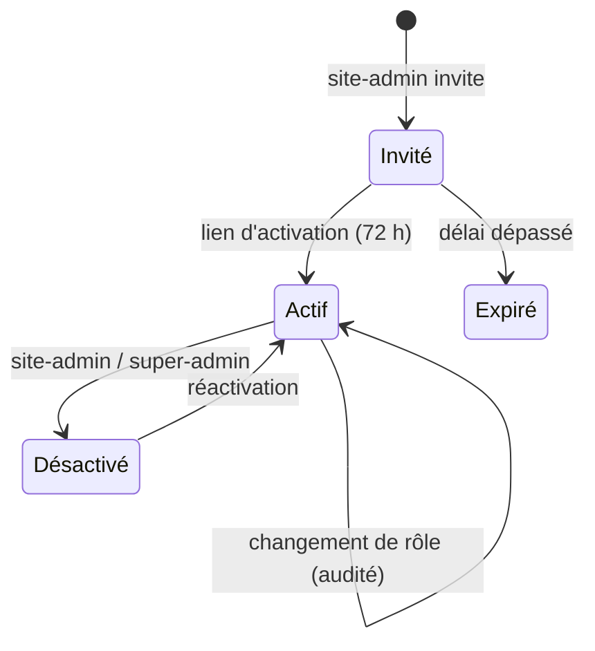

# Authentification, autorisation, comptes

## Trois niveaux

| Niveau | Question | Mécanisme |
|---|---|---|
| Authentification | Qui es-tu ? | Collection `users` (`auth: true`), SSO OIDC optionnel, clés API pour la CI |
| Autorisation | Que peux-tu faire, et où ? | Rôle plateforme + rôle par site, fonctions `access` Payload |
| Gestion des comptes | Cycle de vie | Invitation, activation, désactivation, audit |

## Authentification

- Mot de passe : `maxLoginAttempts: 5`, `lockTime: 15 min`, vérification d'e-mail obligatoire.
- Sessions : cookie `HttpOnly`, `Secure`, `SameSite=Lax`, durée `tokenExpiration: 2h`.
- SSO OIDC (Google Workspace, Entra ID) : la 2FA est imposée par le fournisseur d'identité.
- Comptes techniques : `useAPIKey: true`, un compte par usage (CI scan, revalidation), rôle minimal.

## Matrice des rôles par site

| Action | viewer | author | editor | site-admin | super-admin |
|---|:-:|:-:|:-:|:-:|:-:|
| Lire pages, menus, flow | ✔ | ✔ | ✔ | ✔ | ✔ |
| Créer / modifier ses brouillons | | ✔ | ✔ | ✔ | ✔ |
| Modifier les brouillons des autres | | | ✔ | ✔ | ✔ |
| Soumettre en relecture | | ✔ | ✔ | ✔ | ✔ |
| Approuver | | | ✔ | ✔ | ✔ |
| Publier, planifier, créer une release | | | ✔ | ✔ | ✔ |
| Gérer fragments et menus | | | ✔ | ✔ | ✔ |
| Gérer les comptes du site | | | | ✔ | ✔ |
| Gérer les sites et rôles plateforme | | | | | ✔ |

## Règles d'implémentation

- Toute fonction `access` renvoie une **contrainte `where`** (`{ site: { in: [...] } }`) plutôt qu'un
  booléen quand l'accès dépend du site : le filtre s'applique aux listes, au GraphQL et à la Local API.
- La Local API ignore l'accès par défaut : tout appel fait au nom d'un utilisateur passe
  `overrideAccess: false, user`.
- Dans Payload, *modifier* inclut *publier* : un hook `beforeChange` refuse `_status: 'published'`
  et les transitions de `workflowStatus` non autorisées pour le rôle.
- Les champs sensibles (`platformRole`, `siteRoles`) ont un `access.update` au niveau du champ.
- Un compte désactivé (`active: false`) est refusé par toutes les fonctions `access` et au login.

## Cycle de vie d'un compte

Aucun compte n'est supprimé : l'historique (`audit-log`, versions) doit rester attribuable.
