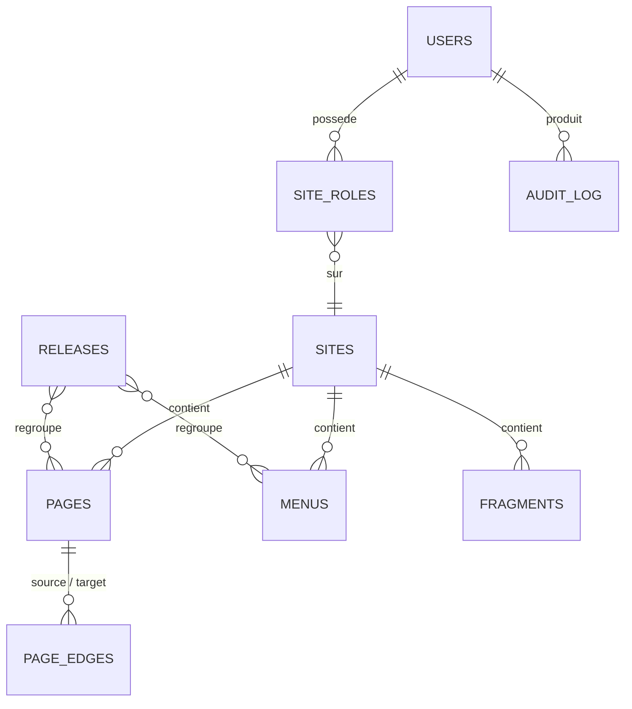

# Modèle de données

## Collections

| Collection | Champs clés | Versions |
|---|---|---|
| `sites` | `name`, `domain`, `previewUrl`, `revalidateUrl`, `locales` | non |
| `pages` | `title`, `slug`, `site`, `parent`, `layout` (blocs), `seo`, `flowPosition`, `workflowStatus` | brouillons + planification |
| `fragments` | `name`, `site`, `layout` (blocs) — composants réutilisables | brouillons |
| `menus` | `site`, `location` (header, footer…), `items[]` (`linkField`) | brouillons |
| `media` | upload S3, `alt` obligatoire | non |
| `users` | `auth`, `platformRole`, `siteRoles[]`, `active`, `apiKey` | non |
| `releases` | `name`, `site`, `items[]` (relation polymorphe), `publishAt`, `status` | non |
| `page-edges` | index dérivé : `site`, `source`, `target`, `kind`, `viaBlockId`, `origin`, `targetStatus` | non |
| `audit-log` | `user`, `site`, `action`, `collection`, `docId`, `diff`, `at` | non (append-only) |

## Blocs

Chaque bloc du registre (`packages/blocks/<slug>/`) expose :

- `config.ts` — `Block` Payload (champs, slots `blocks` imbriqués et blocs autorisés) ;
- `Component.tsx` — rendu React (Server Component par défaut) ;
- `meta.ts` — libellé, icône, couleur du nœud dans le flow, champs qui produisent des arêtes.

Les champs de lien utilisent toujours `linkField()` (voir [links.md](links.md)).

## Position dans le flow

`pages.flowPosition` (`{ x, y, locked }`) est la seule donnée de présentation persistée. Une position
vide est calculée par ELK à l'ouverture de la vue.
