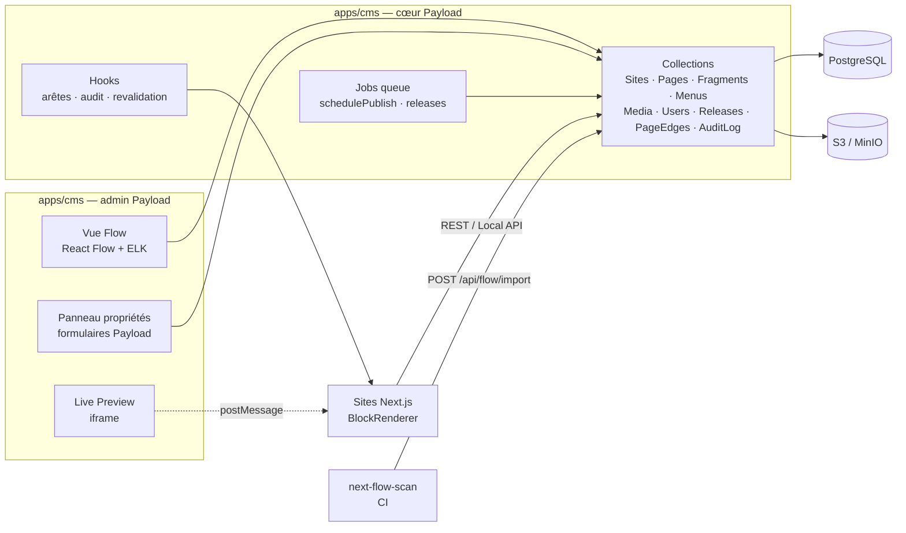

# Vue d'ensemble

## Principes

1. **Le contenu est la source de vérité de la navigation.** Les arêtes du flow sont *dérivées* des
   champs de lien des pages, des menus et des redirections. On ne dessine jamais une arête à la main
   sans qu'un lien réel existe derrière.
2. **Un composant = un schéma + un rendu**, définis une seule fois dans `packages/blocks` et partagés
   entre le CMS et les sites.
3. **Tout ce qui est publié est versionné.** Brouillon, relecture, planification et releases passent
   par les versions Payload.
4. **Le code reste maître de ce qu'il définit.** Ce que `next-flow-scan` détecte dans le code est
   importé avec `origin: "code"` et affiché verrouillé.

## Composants du système

## Stack

| Couche | Choix | Raison |
|---|---|---|
| CMS | Payload 3 dans Next.js | Auth, versions, brouillons, planification et jobs natifs |
| Base | PostgreSQL (`@payloadcms/db-postgres`) | Transactions pour les releases, JSONB |
| Médias | S3 / MinIO (`@payloadcms/storage-s3`) | Indépendant de l'hébergeur |
| Éditeur de flow | `@xyflow/react` + `elkjs` | Référence des éditeurs à nœuds, auto-layout |
| Multi-site | `@payloadcms/plugin-multi-tenant` | Isolation des données par site |
| Redirections | `@payloadcms/plugin-redirects` | 301 automatiques au changement de slug |
| Monorepo | pnpm + Turborepo | Registre partagé CMS / sites |
| Tests | Vitest, Playwright | Unitaires, E2E de l'éditeur |
| Analyse de code | ts-morph | Reconstitution du flow |

> Payload évolue très vite et toutes les versions de Next.js ne lui sont pas compatibles :
> les versions de `payload`, `@payloadcms/*` et `next` sont figées ensemble (voir ADR 0001).
