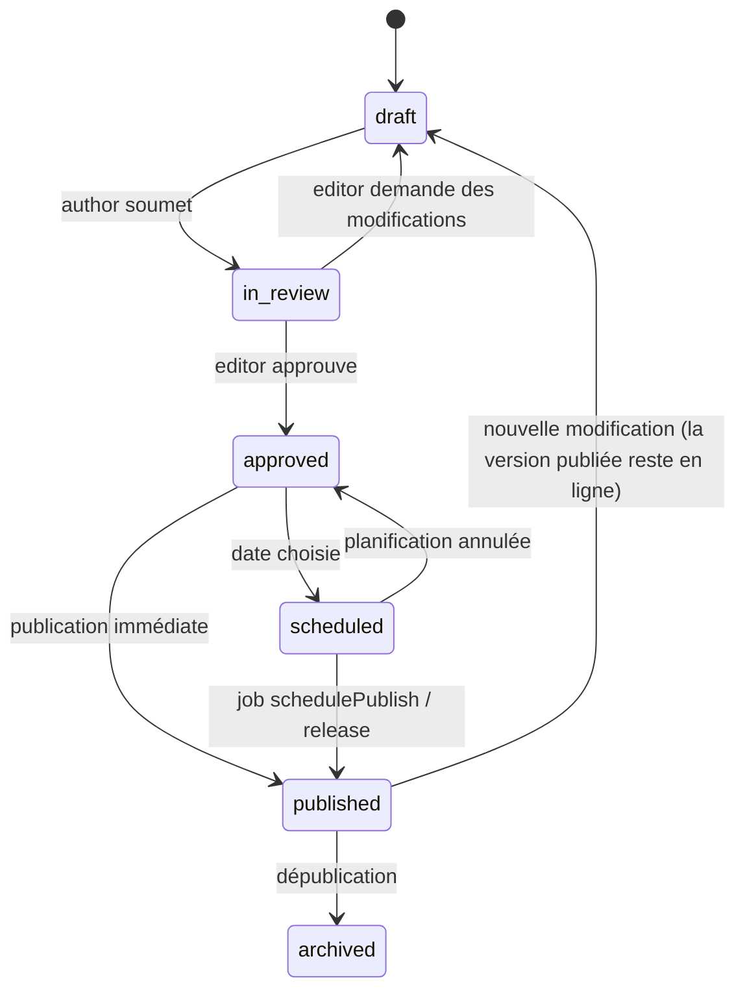

# Édition et publication

## Workflow éditorial



- `workflowStatus` complète le `_status` natif de Payload (`draft` / `published`).
- Les transitions sont validées par rôle dans un hook `beforeChange` et tracées dans `audit-log`.
- L'auto-sauvegarde des brouillons est active (`versions.drafts.autosave`).

## Planification d'un document

`versions.drafts.schedulePublish: true` ajoute le sélecteur de date dans l'admin et met en file une
tâche `schedulePublish`. En production, un service dédié exécute la file :

```bash
pnpm payload jobs:run --cron "* * * * *" --queue default --handle-schedules
```

## Releases (publication groupée)

Une release regroupe plusieurs brouillons (pages, menus, fragments) publiés **ensemble et
atomiquement** à une date donnée.

1. L'éditeur crée une release, y ajoute des documents depuis le flow (sélection multiple).
2. Validation à la planification : liens vers pages non publiées hors release, pages orphelines.
3. Une tâche `publishRelease` programmée publie tous les documents dans une transaction.
4. En cas d'échec : rollback, release en `failed`, notification.
5. Revalidation des sites concernés (`revalidateTag` par page et `menu:<location>`).

Dans le flow, une release s'affiche en **calque** : le graphe futur, avec les nœuds et arêtes ajoutés
ou retirés mis en évidence. L'aperçu accepte `?release=<id>`.

## Retour arrière

- Restaurer une version d'un document (natif Payload).
- Annuler une release publiée : republier la version précédente de chacun de ses documents, dans
  une transaction.
