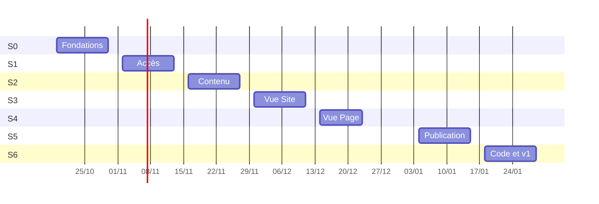

# Feuille de route

<!-- BEGIN:GENERATED (pnpm backlog:sprints) — ne pas éditer -->

| Sprint | Dates | Objectif | Pts | Avancement |
|---|---|---|--:|---|
| [Sprint 0 — Fondations](sprint-00.md) | 2026-10-19 → 2026-10-30 | Un environnement de développement reproductible où le CMS démarre et la CI valide chaque PR. | 18 | 0/18 |
| [Sprint 1 — Accès](sprint-01.md) | 2026-11-02 → 2026-11-13 | Chaque utilisateur ne voit et ne fait que ce que son rôle permet, sur ses seuls sites. | 20 | 0/20 |
| [Sprint 2 — Contenu](sprint-02.md) | 2026-11-16 → 2026-11-27 | Composer une page de blocs dans le CMS et la voir rendue sur le site de démonstration. | 19 | 0/19 |
| [Sprint 3 — Vue Site](sprint-03.md) | 2026-11-30 → 2026-12-11 | Voir et faire évoluer la navigation du site dans un graphe fidèle au contenu. | 21 | 0/21 |
| [Sprint 4 — Vue Page](sprint-04.md) | 2026-12-14 → 2026-12-23 | Éditer une page bloc par bloc depuis son graphe, avec l'aperçu synchronisé. | 16 | 0/16 |
| [Sprint 5 — Publication](sprint-05.md) | 2027-01-04 → 2027-01-15 | Relire, planifier et publier des ensembles cohérents sans casser la navigation. | 20 | 0/20 |
| [Sprint 6 — Code et v1](sprint-06.md) | 2027-01-18 → 2027-01-29 | Aligner le flow sur le code des sites et livrer une v1 exploitable. | 20 | 0/20 |

## Epics

| Epic | Description | Stories | Pts |
|---|---|--:|--:|
| E1 — Fondations | Monorepo, environnement de dev, Payload, CI | 6 | 18 |
| E2 — Authentification et autorisation | Rôles par site, accès, comptes, audit | 6 | 20 |
| E3 — Contenu et registre de blocs | Pages, liens, menus, blocs, rendu, aperçu | 5 | 19 |
| E4 — Vue Site | Graphe des pages et de la navigation | 6 | 21 |
| E5 — Vue Page | Graphe des composants d'une page | 5 | 16 |
| E6 — Édition et publication | Workflow, planification, releases, revalidation | 6 | 23 |
| E7 — Reconstitution depuis le code | next-flow-scan et import | 3 | 10 |
| E8 — Qualité et exploitation | Performance, accessibilité, déploiement | 2 | 7 |
<!-- END:GENERATED -->
